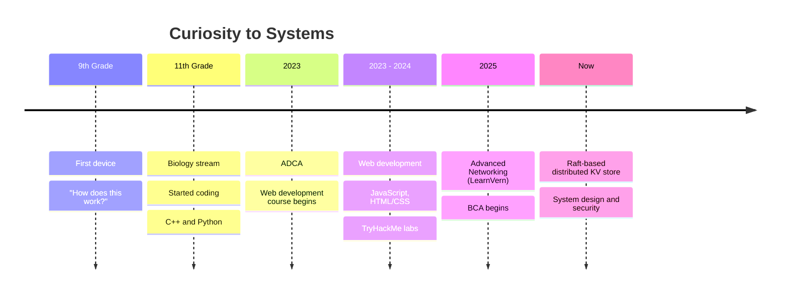

<!-- Is file ko repo "konwxmecom/konwxmecom" me README.md naam se daalna -->

  

 

<!-- ============ SNAPSHOT ============ -->
<table align="center">
  <tr>
    <td align="center" width="260">
      <h3>🎓</h3>
      <b>BCA</b> 
      Ongoing
    </td>
    <td align="center" width="260">
      <h3>🌱</h3>
      <b>Self-taught</b> 
      Coding since 11th grade
    </td>
    <td align="center" width="260">
      <h3>🎯</h3>
      <b>Focus</b> 
      Distributed systems and security
    </td>
  </tr>
</table>

 

**BCA student. Self-taught developer. Builder of systems.** 
Started in Biology, chose to build instead of following the usual path.

 

## 👣 Journey

 

## 🧰 Tech Stack

**Languages** 
  

**Backend and APIs** 

  

**Tools and Platforms** 
  

**Security** 

  

**Domains** 

 

## 🎯 Current Focus

<table align="center">
  <tr>
    <td align="center" width="260">
      <h3>🛡️</h3>
      <b>Cybersecurity</b> 
      Learning through TryHackMe labs now that web development is covered
    </td>
    <td align="center" width="260">
      <h3>🐳</h3>
      <b>DevOps and Docker</b> 
      Exploring containers, deployment and real-world workflows
    </td>
    <td align="center" width="260">
      <h3>🧩</h3>
      <b>Distributed Systems</b> 
      Building a Raft-based KV store in C++ and gRPC
    </td>
  </tr>
</table>

 

- 🏗️ Building resilient, scalable, and maintainable systems
- 🚀 Writing software that runs and survives in production

 

## 🎓 Education and Certifications

<table>
  <tr>
    <td align="center" width="200"> Bachelor of Computer Applications</td>
    <td align="center" width="200"> Advanced Diploma in Computer Applications</td>
    <td align="center" width="200"> Web development course</td>
  </tr>
  <tr>
    <td align="center" width="200"> LearnVern</td>
    <td align="center" width="200"> Hands-on security labs</td>
    <td align="center" width="200"> Always learning</td>
  </tr>
</table>

 

## 🚀 Featured Project

 

 

## 📊 Stats

 

## 🤝 Connect

  

> **"Don't follow the traditional path. Build your own."**

